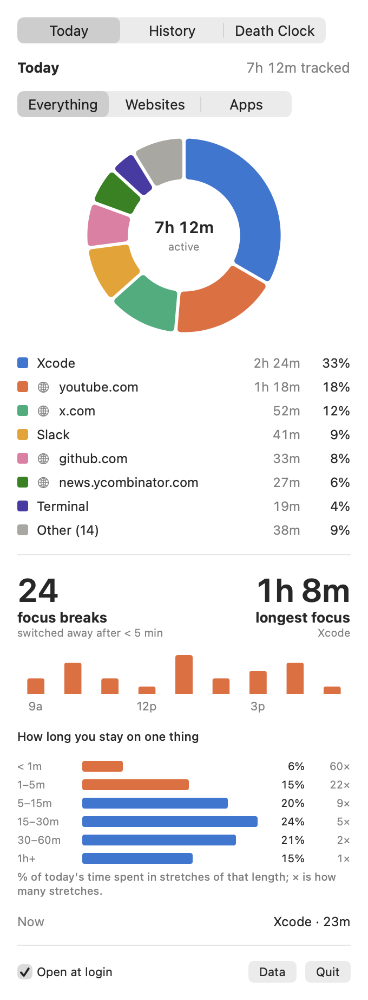
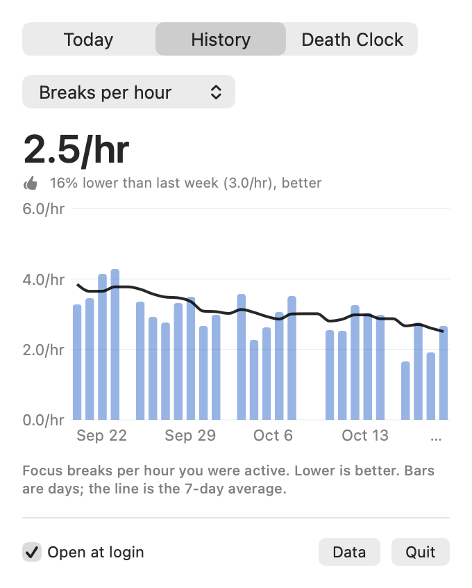
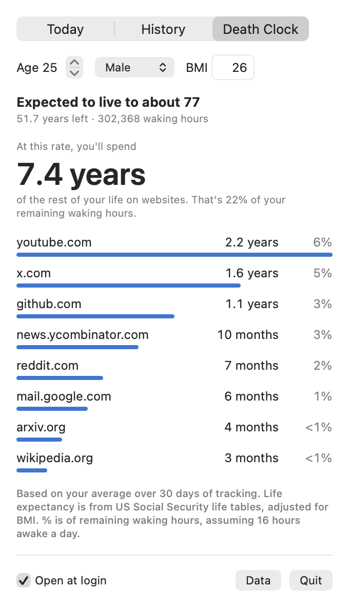

# Internet Death Clock

A macOS menu bar app (plus an iPhone companion) that tracks where your time goes and projects it over the rest of your expected life.

<p>
  
  
  
</p>

<sub>Screenshots use made-up data.</sub>

## What it does

- **Today:** time per app and per website (frontmost browser tab), plus focus breaks (switching away after < 5 min) and how long you stay on one thing.
- **History:** daily focus metrics with a 7-day average.
- **Death Clock:** your average daily website time × your remaining life expectancy (US SSA life tables, adjusted for BMI). Pops up on wake and unlock.
- **iPhone:** adds phone usage via Screen Time and shows the Mac's history and profile, synced through iCloud.

Browsers: Safari, Chrome, Arc, Brave, Edge, Vivaldi, Opera and Chromium via Automation; Firefox via Accessibility. Idle time (3+ min without input) isn't counted. Data stays local in `~/Library/Application Support/InternetDeathClock/`, with daily summaries synced to iCloud.

## Build

Requires Xcode, [XcodeGen](https://github.com/yonaskolb/XcodeGen) (`brew install xcodegen`), macOS 14+ and iOS 17+. Set `DEVELOPMENT_TEAM` and `bundleIdPrefix` in `project.yml` to your own.

```sh
./build.sh --install   # build the Mac app, copy it to /Applications, and launch it
./phone.sh             # build the iPhone app and install it on a connected iPhone
```

The iPhone app needs Apple's Family Controls entitlement.
